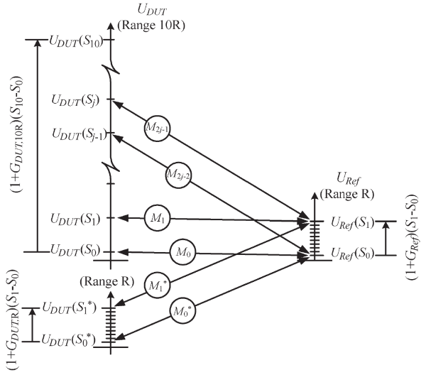
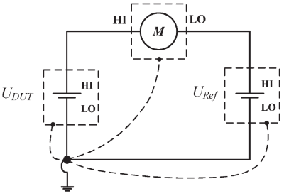
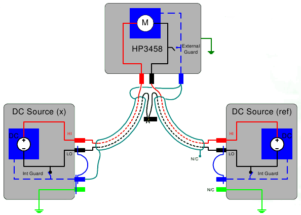
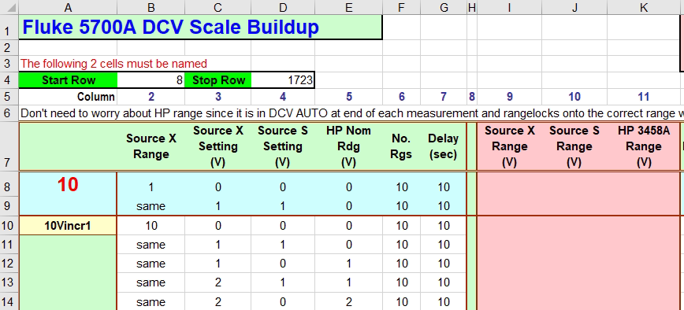
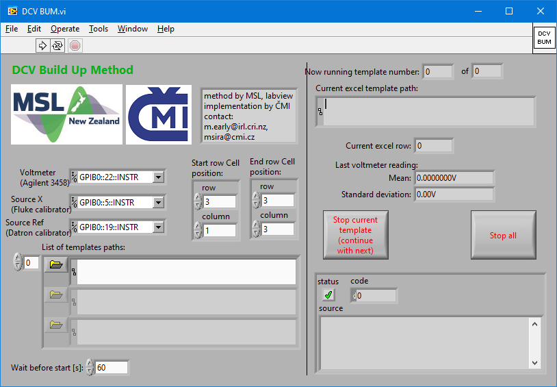

# Stuff related to the Build-Up Method for the DC Voltage Scale of a Source

This repository contains various things related to the Build-Up Method for the
DC Voltage Scale of a Source.

## 1. Build-Up Method

### 1.1. What is Build-Up Method?

The Build-Up Method is a simple **method to build up the dc voltage scale** of a
source.

Originally the method was developed by L. A. Christian from MSL (Measurements Standards Laboratory of New Zealand, MSL),
see [Christian2000], [pdf file with abstract](doc/Christian%20-%202000%20-%20A%20new%20method%20for%20measuring%20ratios%20of%20dc%20voltages%20f.pdf).
M. D. Early (MSL) continued work on the method, see [Early2011], [pdf file with poster](doc/Early%2C%20Christian%20-%20poster%20at%20EURAMET%20meeting%202011%20-%20A%20Simple%20Build-up%20Method%20for%20the%20DC%20Voltage%20Scale%20of%20a%20Source.pdf)
Next M. Šíra started comparison of the method against a divider,
see [Šíra2012], [pdf file with abstract](`doc/Šíra%20et%20al.%20-%202012%20-%20Comparison%20of%20the%20Reference%20Step%20Method%20with%20a%20MI%2080008001%20potentiometer.pdf`).
B.-O. Andersson, O. Gunnarsson and K.-E. Rydler did comparison against quantum standard.
Later the validation of the method was done
by group M. D. Early, M. Šíra, B.-O. Andersson, L. A. Christian, O. Gunnarsson and K.-E. Rydler,
see [Early2013], [pdf file with paper](doc/Early%20et%20al.%20-%202013%20-%20A%20Simple%20Build-Up%20Method%20for%20the%20DC%20Voltage%20Scale%20of%20a%20Source.pdf).

### 1.2. References

[Christian2000]: L. A. Christian, ‘A new method for measuring ratios of dc voltages from 10 V to 1100 V’, in Conference on Precision Electromagnetic Measurements. Conference Digest. CPEM 2000 (Cat. No.00CH37031), IEEE, 2000, pp. 665–666. doi: 10.1109/CPEM.2000.851187.

[Early2011]: M. D. Early, L. A. Christian, ‘A Simple Build-up Method for the DC Voltage Scale of a Source’, poster presented at EURAME TC-EM meeting 2011.

[Šíra2012]: M. Šíra, M. Early, J. Streit, and L. Christian, ‘Comparison of the Reference Step Method with a MI 8000/8001 potentiometer’, in 2012 Conference on Precision Electromagnetic Measurements (CPEM), 2012, pp. 540–541. doi: 10.1109/CPEM.2012.6251042.

[Early2013]: M. D. Early et al., ‘A Simple Build-Up Method for the DC Voltage Scale of a Source’, IEEE Transactions on Instrumentation and Measurement, vol. 62, no. 6, pp. 1600–1607, 2013, doi: 10.1109/TIM.2012.2230734.

## 2. What can you do?

You can read documentation, understand the method, use the resources and implement the method in your laboratory.

If you find this website useful, **tell others**.

If you find the method useful, use it and **[cite the paper Early2013](1.2.-references)**.

If you implement the method into some new software, **share your software**. You can add it into this repository using typical fork-and-pull-request workflow.

## 3. How the Build-Up Method works?

The method relies on the superb differential linearity of a multimeter HP/Keysight/Agilent
3458A. One multimeter and two calibrators are required: one calibrator to be calibrated,
as DUT (Device Under Test), and the other calibrator to be used as a transfer standard.
General overview is shown in the . For details, see the paper [Early2013](1.2.-references).

The Build-up method is used to measure ratios of voltages, so one measurement
point has to be referenced to and absolute voltage standard, usually 10 V is
referenced to a Zener voltage standard. The rest of the calibration points are
calculated using the absolutely calibrated point and voltage ratios calibrated
using the Build-up method.

The key advantages of this method are that it
relies on equipment that is readily available in most high-level
laboratories and can be fully automated.

The Type A uncertainties achieved by this approach can be less than 0.1 μV/V.
The expanded uncertainty can be better than 0.2 μV/V up to 1000 V, limited only
by the performance of the instruments used.

The measurement setup, optimized for calibrator Fluke 5720A as a DUT and Datron 4808 as reference, was developed in MSL (figure by M. D. Early):

## 4. What is in this repository?

### 4.1. Documentation

The directory [`doc`](doc/) contains various pdf files with posters, abstracts and
papers related to the Build-Up Method.

### 4.2. MSL spreadsheet

MSL shared their spreadsheet, see directory [`MSL spreadsheet`](MSL_spreadsheet/).
The spreadsheet is used to:

1. sets measurement points for the Build-Up Method,
2. calculates calibration values from measurement results,

The spreadsheet requires following plugins:

1. Assert (works at least with version  0.71)
2. CGUM (works at least with version 0.66)
3. SGUM (works at least with version 0.96)

All three plugins were developed by B. D. Hall, Measurement Standards Laboratory of New Zealand, Lower Hutt, New Zealand.

### 4.3. CMI implementation in LabVIEW

#### 4.3.1. What is it?

The directory [`CMI implementation in LabVIEW`](CMI_implementation_-_LabVIEW/) contains the implementation of
the Build-Up Method as a software developed in LabVIEW. It is a simple software
that can control calibrators and multimeters, read measurement points from an
spreadsheet file, setup devices, run measurement and write results into the [MSL spreadsheet
file](4-2-msl-spreadsheet).

Latest build is [1.3.1](CMI_implementation_in_LabVIEW/builds/1.3.1/),
built for windows, requires [LabVIEW Runtime Engine 2011, 32 bit](https://www.ni.com/en/support/downloads/software-products/download.labview-runtime.html).

#### 4.3.2. How to use it?

Go to the directory with latest build. Run `BuildUpMethod.exe`. You should see this:

On the left, select addresses of your DUT, calibrator and multimeter, select
the spreadsheet file with measurement points, use multiple if you want to run
long series of measurements. The spreadsheet file is in the directory with the
executable. Then click `Run` button (rightward arrow) in the top row of icons.

The measurement results will be written into the spreadsheet file and
calibration values will be calculated by the spreadsheet.

To obtain absolute values, you have to e.g. compare DUT with Zener voltage
standard at 10 V by your self. This part is not implemented in the software.

## 5. Acknowledgements

This repository is possible only because L. A. Christian and M. D. Early from MSL shared their work, and agreed to release files as publicly available.

L. A. Christian and M. D. Early are not responsible for any licensing issues related to the files in this repository.

## 6. License

The files in this repository are released under GNU General Public License v3, with exception to the following files:

1. `doc/Christian - 2000 - A new method for measuring ratios of dc voltages f.pdf` -- This file is licensed by the author and/or the journal.
1. `doc/Šíra et al. - 2012 - Comparison of the Reference Step Method with a MI 80008001 potentiometer.pdf` -- This file is licensed by the author and/or the journal.
1. `doc/Early et al. - 2013 - A Simple Build-Up Method for the DC Voltage Scale of a Source.pdf` -- This file is licensed by the author and/or the journal.

L. A. Christian and M. D. Early are not responsible for any licensing issues related to the files in this repository.
